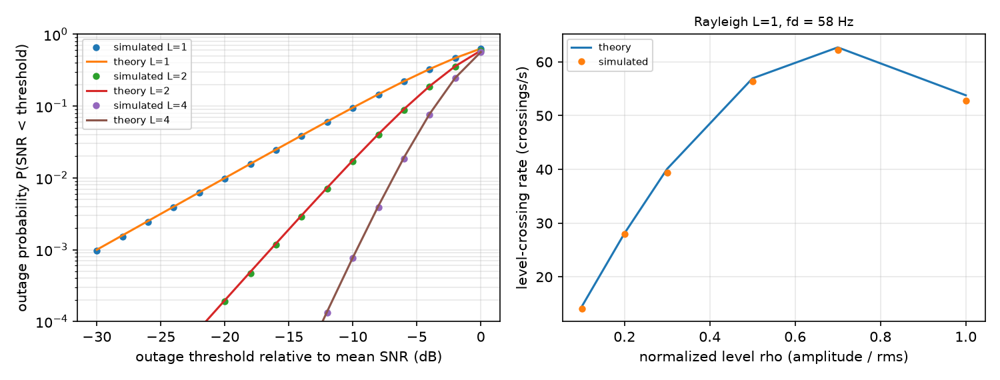
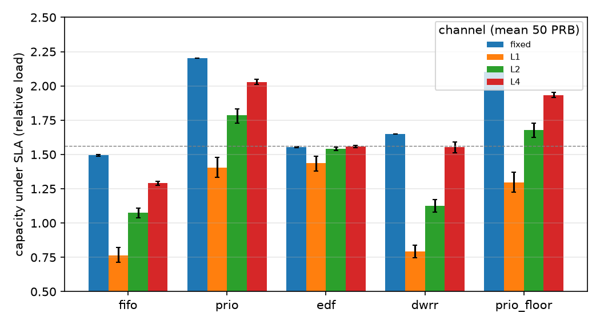
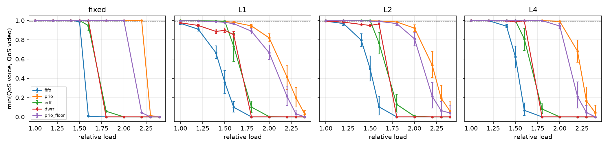

# gNB QoS Scheduler

A multithreaded 5G base-station (gNB) scheduler simulator in C/Pthreads, with a wireless channel model and statistical analysis in Python. It compares FIFO, strict-priority, EDF, and DWRR scheduling of voice, video, and data traffic under congestion, and measures how channel quality (path loss, fading, MRC antenna diversity) changes the outcome.

Course project for Concurrency and Real-Time Systems and Wireless Communications (UFSC). The project plan is in [docs/Final_Work_Plan.md](docs/Final_Work_Plan.md).

## Scope

This is a slot-level MAC scheduler **simulator**, not a 5G emulator or a full protocol stack.

- **Modeled:** a real-time multithreaded scheduler (1-ms slots, `SCHED_FIFO`, CPU affinity) allocating PRBs among voice, video, and data classes, driven by a PRB-capacity trace from a statistical channel (path loss, log-normal shadowing, Rayleigh fading with Jakes Doppler, MRC diversity).
- **Not modeled:** PHY/RLC/PDCP/RRC, HARQ, discrete CQI/MCS, scheduling across multiple users, interference, and handover. The channel model is validated against theory (outage, level-crossing rate), but the scheduler results are not cross-validated against another simulator.
- **Use it for:** comparing scheduling policies and diversity under congestion, and studying real-time execution effects.
- **Do not use it for:** absolute 5G throughput or capacity figures, or standards-compliance claims.

## Results

All numbers come from paired-seed experiments on native Linux (`SCHED_FIFO`, pinned CPUs, 1-ms slots, 50 PRB/slot baseline). Full tables, confidence intervals, and hypothesis verdicts: **[results/RESULTS_SUMMARY.md](results/RESULTS_SUMMARY.md)**; protocol: [results/EXPERIMENTS.md](results/EXPERIMENTS.md).

### 1. Does the simulator behave correctly?

- **Channel model matches theory.** Simulated Rayleigh outage probability follows the Gamma(L, 1) MRC distribution (max error 0.02 decades for P > 1e-3), and the level-crossing rate matches Clarke's formula within 2%.
- **No machine noise.** With the fixed channel, capacity has zero seed-to-seed variance, so all variability in the other scenarios comes from the fading realization, not from scheduling jitter.
- **Analytic sanity check.** EDF capacity stays between 1.44x and 1.56x in every channel, close to the fluid saturation bound of 1.56x (dashed line in the bar chart below).



### 2. What the simulator shows

SLA capacity is the largest load (relative to a 50 PRB/slot baseline) at which voice and video both keep on-time delivery of at least 99%. Rayleigh channels have the same mean PRBs; L is the number of MRC antenna branches (20 seeds, 95% CI in `results/`).

| Channel | FIFO | DWRR | EDF | Strict priority |
|---|---|---|---|---|
| Fixed | 1.49 | 1.65 | 1.55 | **2.20** |
| Rayleigh, L=1 | 0.77 | 0.79 | 1.44 | **1.41** |
| Rayleigh, L=2 | 1.07 | 1.12 | 1.54 | **1.78** |
| Rayleigh, L=4 | 1.29 | 1.55 | 1.56 | **2.03** |





Key findings:

- **Policy matters most.** Strict priority raises capacity by +0.64 over FIFO under fading. FIFO collapses abruptly (voice QoS from about 1.0 to near 0 between 1.4x and 1.6x on the fixed channel), while priority degrades gracefully and sacrifices data first.
- **Diversity helps every policy.** Going from L=1 to L=4 adds +0.52 (FIFO), +0.62 (priority), and +0.76 (DWRR) of capacity, and also cuts the seed-to-seed spread (priority capacity std 0.17 to 0.04).
- **Fading is costly.** Under single-antenna Rayleigh fading, FIFO and DWRR cannot meet the SLA at the nominal load (capacity below 1.0).
- **Policy beats diversity, but not by much.** Policy gain +0.64 versus diversity gain +0.52 (difference +0.12 [0.03, 0.20]); the verdict is kept as inconclusive.
- **Robust to shadowing.** With 6 dB log-normal shadowing, the policy and diversity gains persist (priority over FIFO +0.58 to +0.66, L=4 over L=1 +0.36 to +0.44), but one cell position can differ a lot from another: per-seed capacity ranges from about 0.3x to 3x.
- **Guaranteed-minimum floors have a cost.** A 1-2 PRB floor for data cuts starvation from up to 525 ms to 3 ms under fading but costs video QoS (up to -0.15 at 2.0x), so it is not a free fix.
- **Burst alignment and speed.** With staggered bursts the policy ranking does not change; at 1.8x only priority and DWRR keep voice QoS at 1.0, while FIFO delivers 0. Higher mobility slightly improves voice QoS (+0.03 at 30 m/s versus 0.3 m/s, priority, 1.5x, L=1), because faster fading averages out within the deadline.
- **Short runs mislead.** Untrimmed runs shorter than 10 s differ by up to 0.30 QoS from 20-s trimmed references, so the experiments use a 1.0 s warm-up and 0.5 s tail trim.

### 3. Conditions and limits

- Results hold for the modeled traffic (voice, video, Poisson data), one representative user, and synchronous bursts; they are comparisons between policies, not absolute 5G capacity figures (see [Scope](#scope)).
- Seed-to-seed variability is intrinsic to fading; use paired differences, quantiles, and many seeds, as done here. See [docs/RUNNING_EXPERIMENTS.md](docs/RUNNING_EXPERIMENTS.md) to reproduce everything with `scripts/reproduce.sh full`.

## Quick Start

On Linux (see [docs/SETUP.md](docs/SETUP.md) for dependencies and real-time setup):

```bash
make -C core                                                    # build
python3 -m venv .venv && source .venv/bin/activate
pip install -r requirements.txt

core/build/gnb_sim --policy prio --load 1.5 --duration 10 --seed 1 --cpu 2 --out results/run.csv
python3 -m analysis.analyze results/run.csv --duration 10      # per-class metrics

python3 -m pytest -q tests                                      # tests
scripts/reproduce.sh smoke                                      # build + tests + one short run
```

The last line of the simulator output ends with `rt=1` when real-time scheduling is active. `rt=0` runs are not valid real-time measurements.

## Documentation

| Document | Contents |
|---|---|
| [docs/SETUP.md](docs/SETUP.md) | Dependencies, real-time Linux setup, installation check |
| [docs/RUNNING_EXPERIMENTS.md](docs/RUNNING_EXPERIMENTS.md) | Running E1-E6, `scripts/reproduce.sh`, options, generic multi-CPU command, report generation |
| [docs/DESIGN.md](docs/DESIGN.md) | Threads, policies, logs, priority inversion, schedulability, extending the project |
| [results/RESULTS_SUMMARY.md](results/RESULTS_SUMMARY.md) | Results, strengths, limitations |
| [results/EXPERIMENTS.md](results/EXPERIMENTS.md) | Pre-registered protocol and verdicts |
| [docs/Final_Work_Plan.md](docs/Final_Work_Plan.md) | Project plan |

## Repository Structure

```text
core/                         Real-time core (C, Pthreads, Linux)
  Makefile                    make | make debug | make clean
  src/sim.h                   Shared types and state (read first)
  src/threads.c               Producers (voice/video/data), scheduler, and monitor
  src/policy.c                Policies: FIFO, strict priority, EDF, DWRR, and priority floor
  src/channel.c               Fixed slot capacity or capacity from a CSV trace
  src/main.c                  CLI, SCHED_FIFO, CPU affinity, and log output
channel/channel_model.py      Path loss + shadowing + Rayleigh (Jakes) + MRC -> PRB trace
analysis/analyze.py           Per-class metrics for one execution
analysis/sweep.py             Policy × load × seed sweep, bootstrap CI, and plots
analysis/experiments.py       Experiments E1-E6 (parallel, resumable)
analysis/exp_report.py        Tables, plots, and verdicts for E1-E6
analysis/schedulability.py    Analytical schedulability tests
analysis/producers.py         Producer wake-up latency
analysis/validate_channel.py  Channel model versus theory
analysis/inversion.py         Priority-inversion experiment
tests/test_python.py          Numerical tests (pytest)
scripts/reproduce.sh          smoke (build, tests, short run) and full (all results) reproduction
.github/workflows/ci.yml      CI: smoke test on every push and pull request
results/                      Outputs: exp/ (E1-E5), summaries, legacy/ (superseded sweeps)
docs/                         Setup, experiments, design notes, project plan
```


## License

MIT, see [LICENSE](LICENSE).
