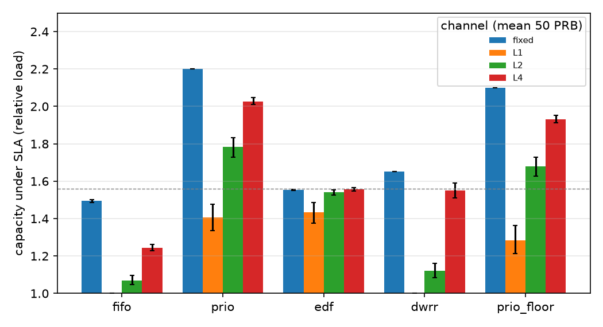
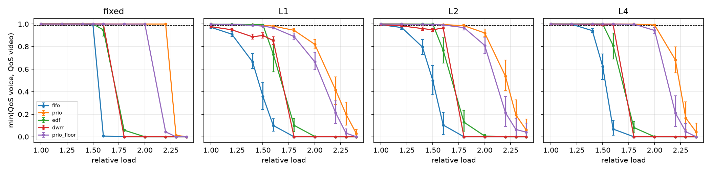
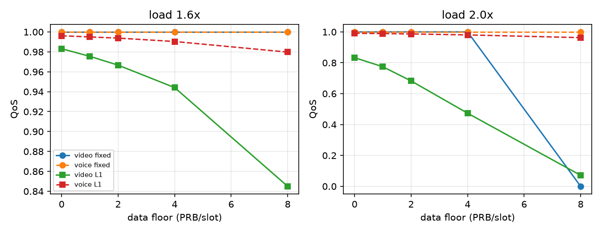
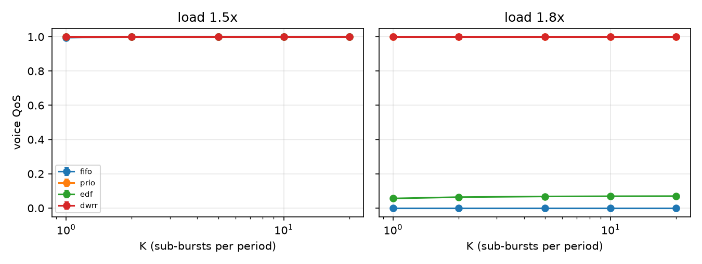
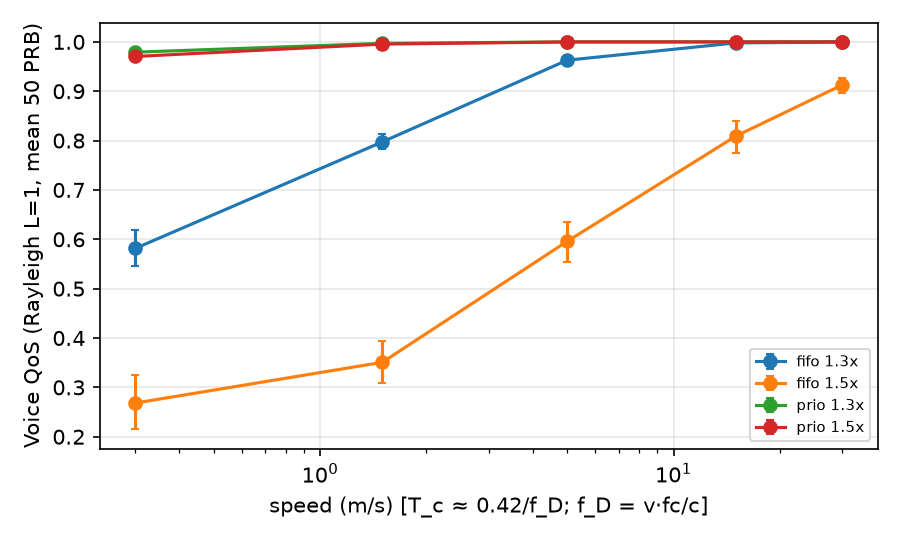
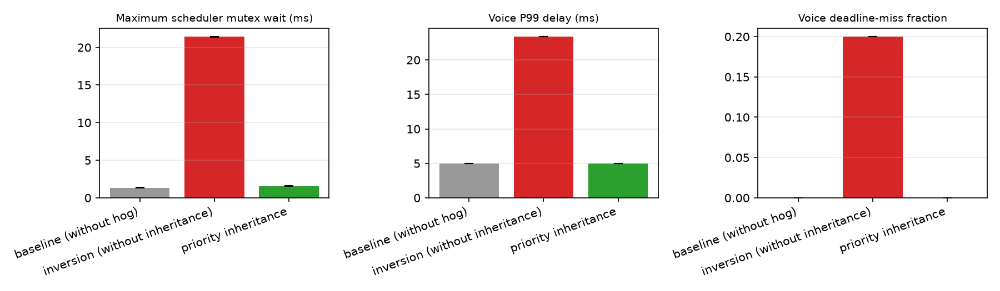
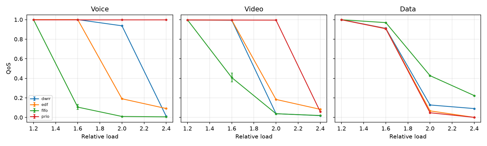

# Experimental Results Summary

Setup and commands: [README](../README.md) and [docs/](../docs/). Protocol and hypotheses: [EXPERIMENTS.md](EXPERIMENTS.md).

**Primary data set (`s40`):** 40 paired seeds per point, native Linux, 6 measurement CPUs, `SCHED_FIFO`, performance governor, 1-ms slots, baseline capacity 50 PRB/slot, 6-s runs with a 1.0-5.5 s measurement window (10-20 s for E4/E5). Rayleigh scenarios use equal mean PRBs for L=1, 2, and 4 MRC branches and no shadowing. Files: `results/exp/E*_raw.csv`, `manifest_s40.json`, `verdict.csv`, plots `results/exp/*.png`, quantiles `E1_*_quantiles.csv`.

## Traffic Model

- Voice: 100 packets, 2 PRB each, every 20 ms, 20-ms deadline.
- Video: 40 packets, 10 PRB each, every 33 ms, 50-ms deadline.
- Data: Poisson arrivals, 20 PRB per packet, 500-ms deadline.
- QoS = packets delivered on time / packets offered. Drops and unserved packets count against QoS.
- SLA: voice QoS >= 0.99 and video QoS >= 0.99. SLA capacity is the largest load multiplier that satisfies it. The baseline is about 64% of capacity and saturation is near 1.56x.

## Strengths and Limits

### What the Simulator Is Good For

- Comparing scheduling policies (FIFO, strict priority, EDF, DWRR) under overload on a real-time Pthreads implementation, with real mutex contention, wake-up latency, and priority inversion.
- Measuring how QoS, data starvation, and SLA capacity change with load, burst structure, and channel diversity.
- Paired, reproducible comparisons: seeds give identical arrivals and channel traces across policies.
- Demonstrating mechanisms (priority inheritance, `mlockall`, starvation floors) with per-slot logs.

### What It Is Not Good For

- Absolute 5G throughput or capacity numbers: there is no HARQ, fragmentation, discrete MCS, or multi-cell interference.
- Multi-user scheduling: the channel sweeps model one representative user, and shadowing is a single static draw per execution (set to 0 in the experiments).
- Worst-case conclusions about realistic traffic: synchronous bursts are the worst case.
- Results from WSL or machines without `SCHED_FIFO` (`rt=0`) or without a performance governor: timing jitter is not controlled.
- Short-run conclusions: runs shorter than about 10 s without warm-up and tail trimming are biased (H6).

## E1: SLA Capacity (H1, H2)

SLA capacity = largest load where voice QoS >= 0.99 and video QoS >= 0.99 (mean, 95% bootstrap CI):

| Channel | fifo | dwrr | edf | prio | prio_floor |
|---|---|---|---|---|---|
| Fixed 50 PRB | 1.50 | 1.60 | 1.58 | **2.20** | 2.00 |
| Rayleigh L=1 | 1.00 | 1.01 | 1.45 | **1.47** [1.41, 1.53] | 1.36 |
| Rayleigh L=2 | 1.11 | 1.18 | 1.55 | **1.80** [1.76, 1.84] | 1.70 |
| Rayleigh L=4 | 1.25 | 1.50 | 1.56 | **1.98** [1.96, 2.00] | 1.89 |

- **Strict priority is the best policy for voice/video**, keeping voice QoS at 0.98 or higher through 2.4x in every channel (1.0 for fixed and L=4), but video collapses near 2.4x and data is sacrificed first.
- **FIFO collapses abruptly:** voice QoS drops from about 1.0 at 1.4x to near 0 at 1.6x (fixed channel).
- **Diversity helps:** going from L=1 to L=4 raises SLA capacity for every policy (H1; for example prio +0.52 [0.46, 0.58]).
- **Strict priority matters more than diversity** for capacity gain (+0.46 vs +0.25 for FIFO L=4 vs L=1), but H2 is formally inconclusive.

### Variability: Where It Comes From

- Fixed channel: zero seed-to-seed variance (capacity std 0.00 for prio and dwrr), so scheduler and machine jitter are negligible.
- Rayleigh channel: all variance comes from the fading realization of each seed. Per-seed `prio` capacity std is 0.19 (L=1), 0.14 (L=2), and 0.09 (L=4), so diversity also reduces variance.
- Example, video QoS under prio at 2.0x: L=1 median 0.81 (5%-95%: 0.62-0.94); L=4 median 0.99 (0.97-1.00).
- QoS is nearly binary near the SLA cliff, so means have large spread there; use the quantile tables and per-seed paired differences. The 0.1-0.2 load grid also quantizes capacity; a finer grid (0.05) is recommended for further work.

## E2-E5: Floor, Bursts, Speed, Truncation

Tables: `results/exp/E2_table.csv`, `E3_table.csv`, `E4_table.csv`, `E5_table.csv`.

## Hypothesis Verdicts

| Hypothesis | Verdict | Result |
|---|---|---|
| H1 Diversity | Supported | L=4 raises SLA capacity for all policies at equal mean PRBs. |
| H2 Policy vs diversity | Inconclusive | Policy gain (+0.46) exceeds diversity gain (+0.25); difference +0.21 [0.15, 0.28]. |
| H3 Minimum floor | Refuted | A 1-2 PRB floor cuts data starvation from up to 525 ms to 3 ms in L=1, but not to <= 1 ms, and costs video QoS (-0.063 at floor 1, 2.0x). Fixed channel: no effect on voice/video and starvation eliminated. |
| H4 Staggered bursts | Supported | No policy-order change for K=1..20. At 1.8x only prio and dwrr keep voice QoS 1.0; fifo is 0. |
| H5 Fading vs deadline | Supported | Voice QoS +0.030 [0.025, 0.035] from 0.3 to 30 m/s (prio, 1.5x, L=1). |
| H6 Truncation bias | Supported | Short untrimmed runs differ by up to 0.30 from 20-s trimmed references (EDF 1.8x). |

## Supporting Experiments (earlier single-machine runs)

Produced by `analysis.sweep`, `analysis.inversion`, `analysis.producers`, `analysis.schedulability`, and `analysis.validate_channel`. Superseded sweeps are in `results/legacy/`.

- **Schedulability:** the analytical test predicts that `prio` protects voice and video until voice-plus-video utilization reaches 1 (about 2.26x), and saturation at 1.56x (`schedulability.csv`).
- **Priority inversion (`priority_inversion.png`):** without inheritance the maximum mutex wait is 21.4 ms and 20% of voice packets miss the 20-ms deadline; with `PTHREAD_PRIO_INHERIT` the wait is 1.6 ms and the miss rate is 0 (baseline without the hog: 1.3 ms).
- **Producer wake latency (`producers.png`):** only the run without `mlockall` exists, so the two memory-locking modes cannot be compared. Voice p99 wake-up latency was 53 us and max 155 us, far below the 20-ms deadline.
- **Channel validation (`channel_validation.png`):** simulated mean PRBs follow the Gamma/MRC theory.
- **Fixed-channel policy behavior (`edf_qos.png`, 20 seeds, 4-s runs):** `prio` kept voice QoS at 1.0 through 2.4x and video collapsed only at 2.4x; `fifo` degraded voice from 1.6x; `edf` showed a domino effect under overload; `dwrr` eliminated data starvation but voice collapsed at 2.4x.

## Suggested Video Demonstration

1. Show voice, video, and data producers feeding queues and the scheduler.
2. Run prio at 1.0x load, then increase to 2.0x and show data starvation.
3. Compare FIFO, strict priority, EDF, and DWRR.
4. Demonstrate priority inversion with and without priority inheritance.
5. Compare Rayleigh 1-antenna and 4-antenna MRC channels.

## Known Limitations

- Synchronous bursts are the worst case; no fragmentation, HARQ, or discrete MCS.
- Shadowing is a single static draw per execution (disabled in E1-E5); channel sweeps model one representative user.
- The fluid analytical model assumes average data rates.
- E1 uses a 0.1-0.2 load grid and 6-s runs, which quantizes capacity; a finer grid and longer runs are recommended (see [docs/RUNNING_EXPERIMENTS.md](../docs/RUNNING_EXPERIMENTS.md)).
